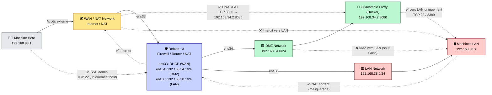

# 01 - Objectifs et architecture du bastion

## 🎯 Objectif du TP

Mettre en place une maquette réseau réaliste en VM autour d’un **routeur/pare-feu Debian 13** disposant de **3 interfaces réseau**, et d’un bastion d’administration **Guacamole (Docker)** placé en DMZ.

L’objectif est de simuler une architecture **WAN / DMZ / LAN**, avec :

✅ Accès **Internet sortant** pour le LAN via NAT/PAT  
✅ Publication du bastion **Guacamole** depuis l’extérieur sur :  
➡️ `http://<IP_EXT>:8080/guacamole`  
✅ Autorisation des connexions du bastion vers le LAN uniquement sur :  
- SSH (`22/tcp`)
- RDP (`3389/tcp`)
✅ Interdiction de tout le reste par défaut  
✅ Administration SSH du routeur **uniquement depuis la machine hôte** (`192.168.88.1`)

---

## 🧱 Architecture et composants

### 🛡 Serveur Debian 13
Rôle :
- Routeur
- Pare-feu (`nftables`)
- NAT/PAT (`masquerade`)
- DNAT (publication du bastion)

Interfaces :
- `ens33` : WAN / NAT (Internet sortant)
- `ens34` : DMZ (Guacamole)
- `ens38` : LAN (réseau interne)

### 🧩 Bastion Guacamole (Docker) en DMZ
- Proxy/reverse proxy docker + guacamole + guacd (stack classique)
- IP DMZ : `192.168.34.2`

### 🖥 Machines LAN
Réseau interne totalement inaccessible depuis l’extérieur.

---

## 🖧 Plan d’adressage (exemple recommandé)

| Zone | Réseau | Passerelle (Debian) |
|------|--------|----------------------|
| WAN/NAT | `192.168.88.0/24` | DHCP |
| DMZ | `192.168.34.0/24` | `192.168.34.1` |
| LAN | `192.168.38.0/24` | `192.168.38.1` |

| Machine | IP |
|--------|----|
| Debian DMZ | `192.168.34.1/24` |
| Debian LAN | `192.168.38.1/24` |
| Guacamole Proxy | `192.168.34.2/24` |
| LAN Clients | `192.168.38.X/24` |
| Host (admin) | `192.168.88.1` |

---

## 🗺️ Schéma Mermaid (réseau + flux)



---

## 🔥 Flux autorisés (règles fonctionnelles)

### 1) Publication Guacamole depuis l’extérieur

| Source | Destination          | Port       | Action             |
| ------ | -------------------- | ---------- | ------------------ |
| WAN    | `192.168.34.2` (DMZ) | `8080/tcp` | ✅ ALLOW (DNAT/PAT) |

📌 NAT :

```text
<IP_EXT>:8080  →  192.168.34.2:8080
```

> ⚠️ Le chemin `/guacamole` est géré par le proxy/reverse proxy Docker (HTTP routing).
> nftables ne filtre que sur IP/port.

---

### 2) Administration SSH du routeur Debian uniquement depuis l’hôte

| Source         | Destination    | Port     | Action  |
| -------------- | -------------- | -------- | ------- |
| `192.168.88.1` | Debian (ens33) | `22/tcp` | ✅ ALLOW |
| autres IP      | Debian (ens33) | `22/tcp` | ❌ DROP  |

---

### 3) LAN → Internet via NAT

| Source                  | Destination  | Action       |
| ----------------------- | ------------ | ------------ |
| LAN (`192.168.38.0/24`) | WAN/Internet | ✅ MASQUERADE |

---

### 4) Guacamole → LAN (SSH/RDP uniquement)

| Source         | Destination             | Ports        | Action  |
| -------------- | ----------------------- | ------------ | ------- |
| `192.168.34.2` | LAN (`192.168.38.0/24`) | `22`, `3389` | ✅ ALLOW |
| `192.168.34.2` | LAN                     | autres       | ❌ DROP  |
